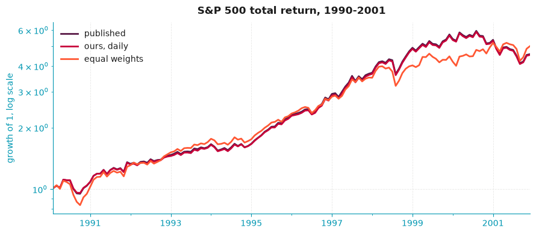
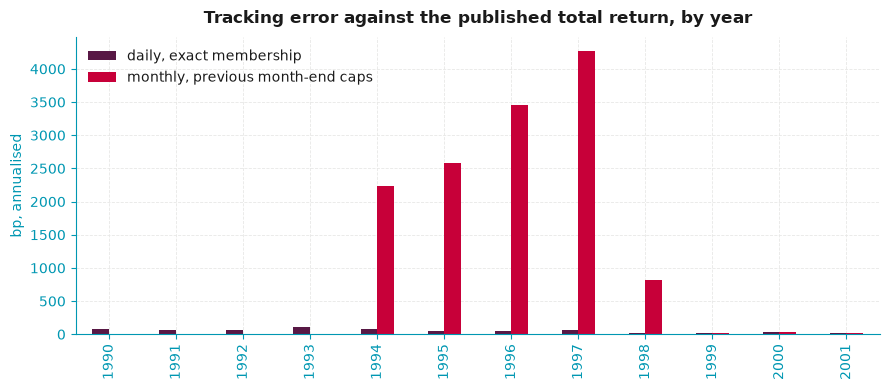
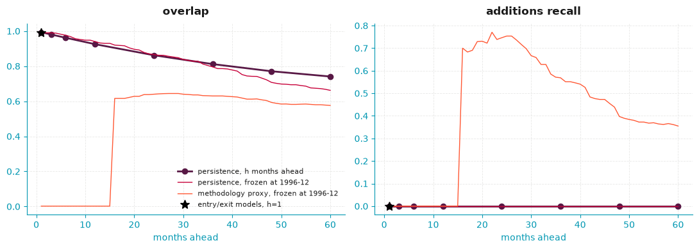
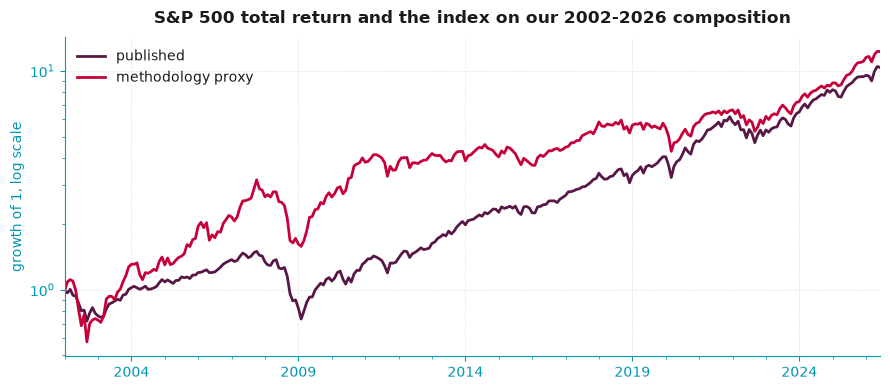

## The question
membership is not a rank cut

What actually decides which companies enter and leave the S&P 500? Can the month-end composition be
rebuilt well enough to reproduce the published total-return index, and can it be predicted past the
data vendor's cutoff, both at *t* and *h* months ahead?

## The rules
measured from membership spells

- Cap rank of additions and deletions, delisting after exit, and turnover by year.
- The methodology's entry screens rebuilt point in time: cap threshold, four positive quarters, liquidity.
- Additions enter at a median cap rank of 575, and in a given month 54% of members rank outside the top 500.

## The reconstruction
checked by its total-return index

Daily total returns are weighted by the previous day's market cap on the exact membership, and
benchmarked against monthly and equal-weight builds, with survivorship-free returns.

| Index, 1990–2001          | Tracking error | Correlation | Slope  |
|---------------------------|---------------:|------------:|-------:|
| Rebuilt, cap-weighted     |        57.5 bp |      0.9992 | 1.0093 |
| Equal-weight, same names  |       623.7 bp |           — | 0.8622 |

## Prediction
at *t* and at *t + h*

- **At *t*:** a rule-based recursion from the last observed composition fills free slots by sector
  share of large-cap value, then by cap. It is frozen at 1996-12 and tested out of sample on 1997–2001.
- **At *t + h*:** entry and exit classifiers (logistic regression, gradient boosting) on size,
  liquidity, momentum, fundamentals and tenure, compared with persistence from 1 to 60 months.
- **Scoring:** overlap, additions and deletions recall and precision, Brier score and ROC AUC;
  correlation, slope and tracking error for the index checks.

| Check                                | Result                                         |
|--------------------------------------|------------------------------------------------|
| Out of sample, 1997–2001             | additions recall 0.4139 (precision 0.1647), vs 0 for persistence |
| Persistence overlap                  | 0.9932 at one month, 0.7409 at five years      |
| Index on predicted names, 2020+      | tracking error 663 bp, correlation 0.9225, slope 0.9844 |

## What this teaches
and what it does not show

Persistence is a hard baseline. The recursion catches additions that persistence cannot, at the cost
of overlap. The limitations are documented openly: missing monthly caps before 1998, today's GICS
sectors used for sector balancing, and no float data after 2005.

## References
code and data

- Code and notebooks: [sp500-composition](https://github.com/gauthierbarre/sp500-composition)
  (`notebooks/01_rules_and_reproduction.ipynb`, `notebooks/02_prediction.ipynb`).
- Data: S&P Global via the MaQI platform. The data is licensed and is not redistributed.
