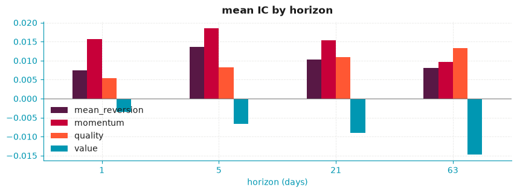
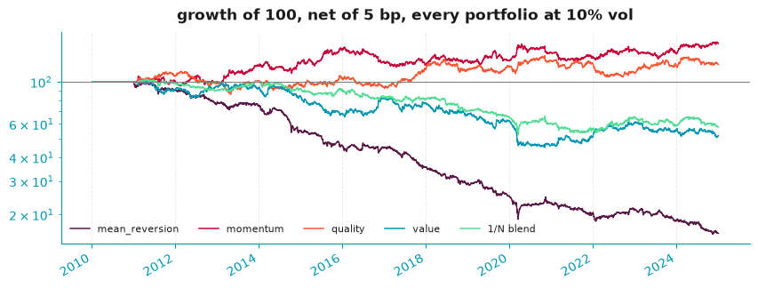
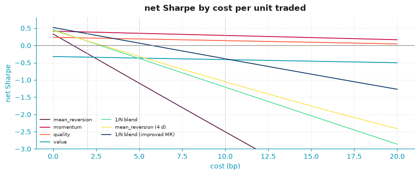

## The question
four signals, and the bill for trading them

Do four classic cross-sectional signals — mean-reversion, momentum, quality and value — still earn
money on US large caps once realistic trading costs are paid? And can a signal that predicts well
but trades too much be made profitable?

## The data
a universe without hindsight

- Point-in-time universe of the 500 largest US stocks, re-selected at each year end, 2011–2024,
  so that no stock enters the sample because it later survived.
- Fundamentals enter on their filing date, not on the end of the fiscal period they describe.
- Documented loopholes are cleaned before any signal is computed: splits, dividends and spin-offs
  in total return, frozen prices, negative book equity, and issue- versus company-level share counts.

## The method
from a ranking to a tradable book

- Signal diagnostics with rank information coefficients (Spearman) across horizons, and decile returns.
- Quintile long-short books scaled to a 10% volatility target, executed the day after the signal.
- Linear costs of 2, 5 and 10 bp per unit traded; turnover and break-even cost for each signal.
- Robustness by sub-period and cost level, plus a live-monitoring design: realised volatility,
  rolling IC, cost ratio, drawdown and sector exposure, each with a threshold and a decision.

## Results
net Sharpe at 10% volatility, 2011–2024

| Portfolio                    | 2 bp  | 5 bp  | 10 bp | Turnover ×/yr | Break-even |
|------------------------------|------:|------:|------:|--------------:|-----------:|
| Momentum (monthly)           |  0.39 |  0.35 |  0.29 |            13 |    33.4 bp |
| Quality (monthly)            |  0.22 |  0.19 |  0.14 |            10 |    24.7 bp |
| Value (monthly)              | −0.34 | −0.37 | −0.41 |             9 |   −35.5 bp |
| Mean-reversion (daily)       | −0.24 | −1.09 | −2.50 |           305 |     1.2 bp |
| Mean-reversion, every 4 days |  0.13 | −0.32 | −1.05 |           159 |     2.9 bp |

## What this teaches
and what it does not show

Slow signals (momentum, quality) survive costs; value lost money even gross over this decade.
Mean-reversion predicts, but its gross edge (≈ 1.2 bp per unit traded) sits below the cheapest
cost. Rebalancing it every 4 days halves turnover and turns the 2 bp Sharpe positive — a frequency
chosen in-sample, so flagged as fragile.

With 14 years of data the standard error of a Sharpe ratio is ≈ 0.27: even momentum is not
statistically significant, which the project states explicitly.

## References
code and data

- Code and notebooks: [US-equity-signals](https://github.com/gauthierbarre/US-equity-signals)
  (`01_data.ipynb`, `02_strategy.ipynb`).
- Data: S&P Global Compustat via the MaQI platform. The data is licensed and is not redistributed.
